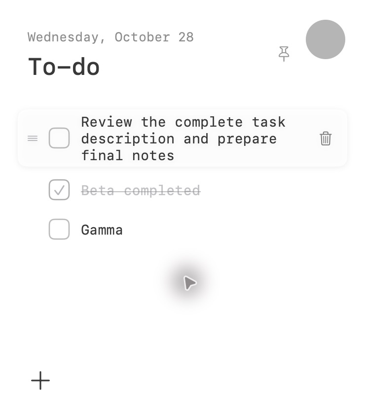
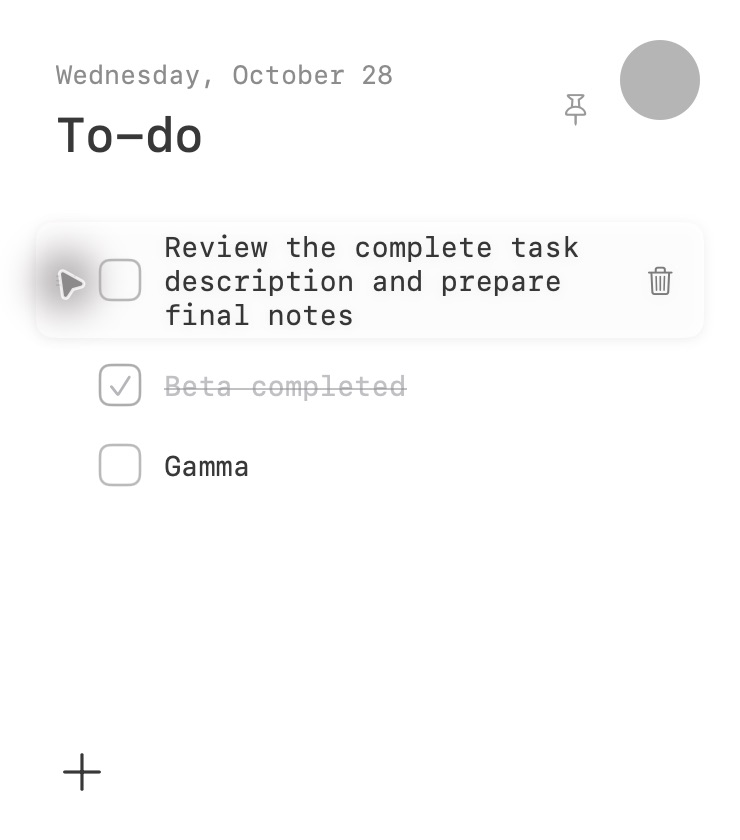
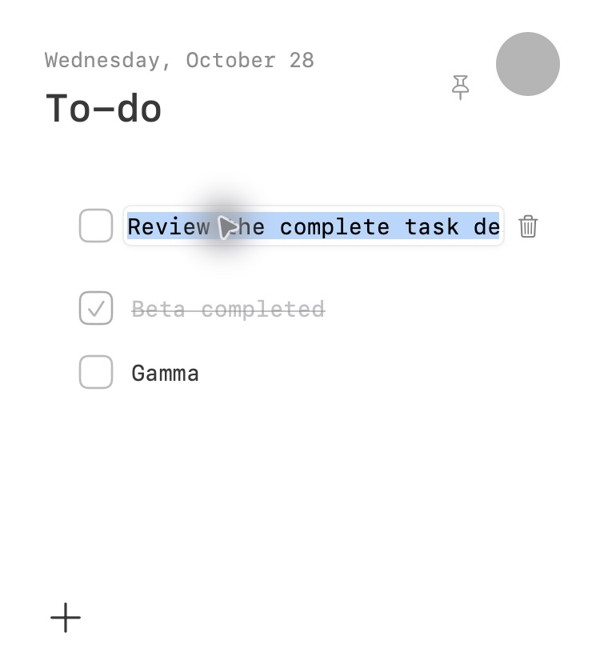

# DailyDot

一个安静、极简的原生 macOS 桌面待办小工具，使用 **SwiftUI + AppKit** 构建。

平时收起为浅灰色圆点，点击展开当天清单。支持任务排序、双击编辑、每日迁移和本地自动保存。

## 效果图

以下为实际运行截图，使用独立演示数据，不含个人清单。

| 展开清单 | 悬停与拖动手柄 |
| --- | --- |
|  |  |

| 双击内联编辑 | 收起状态 |
| --- | --- |
|  |  |

## 功能

- 新增、完成、删除任务；完成项保留在当天清单中，并弱化显示。
- 从任务文字区域或手柄拖拽排序，显示插入线并保存顺序。
- 双击文字原位编辑：Enter 保存、Esc 取消、点击外部保存；空内容恢复原文。
- 每天自动切换，仅带入最近一次记录中的未完成任务，旧日期历史保留。
- UserDefaults + Codable JSON 自动持久化，无账号、无服务器。
- 收起圆点保持悬浮；展开后默认是普通窗口，可通过图钉置顶并切换为半透明背景。
- 圆点锚定的曲线收束/展开动画，各 0.4 秒，支持系统“减少动态效果”。
- 多显示器定位及应用重启后的圆点位置恢复。

当前展开窗口为 **370 × 420 pt**，任务字体 **14 pt**，单行任务高度 **35 pt**（多行内容自适应）。

## 运行

要求 macOS 13 或更高版本；推荐使用 Xcode 16 或更新版本。无需第三方依赖。

```sh
git clone https://github.com/GnoriQnap/DailyDot.git
cd DailyDot
open outputs/DailyDot/DailyDot.xcodeproj
```

在 Xcode 中选择 **DailyDot → My Mac**，按 **⌘R** 运行。也可以打开 `outputs/DailyDot/Package.swift`。

```sh
swift run --package-path outputs/DailyDot DailyDot
```

## 构建与测试

```sh
xcodebuild -project outputs/DailyDot/DailyDot.xcodeproj \
  -scheme DailyDot -configuration Debug \
  -derivedDataPath /tmp/DailyDotBuild CODE_SIGNING_ALLOWED=NO build

swift test --package-path outputs/DailyDot
```

已在 Xcode 16.4 / Apple Silicon 上完成构建，8 项数据测试通过。已实际验证主要拖拽排序、双击编辑与保存交互。长列表拖动时的边缘自动滚动尚未完成实测。

## 代码结构

```text
outputs/DailyDot/
├── DailyDot.xcodeproj/
├── Package.swift
├── Sources/DailyDot/
│   ├── AppDelegate.swift       # 生命周期与日期检查
│   ├── WindowController.swift  # 窗口层级、定位和收束动画
│   ├── ContentView.swift       # 清单、插入指示和行布局
│   ├── RowInteraction.swift    # 原生拖拽、完整行预览与文本编辑
│   ├── TaskStore.swift         # 保存、按日期归档、排序和编辑
│   └── TodoTask.swift          # 数据模型
├── Tests/DailyDotTests/
└── docs/images/                # 实际运行效果图
```

详细实现和迭代记录见 [项目 README](outputs/DailyDot/README.md)。本仓库包含源码和效果图，不包含本机调试应用、临时构建目录或旧版演示视频。
